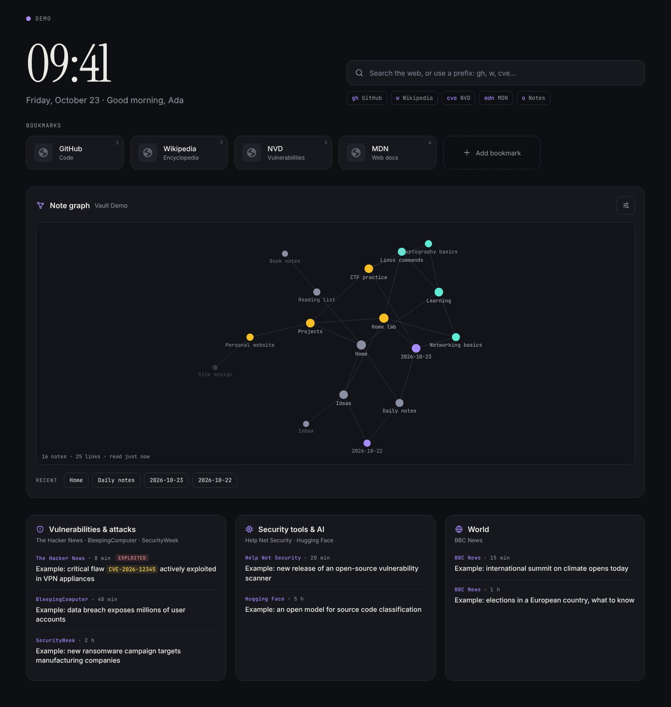
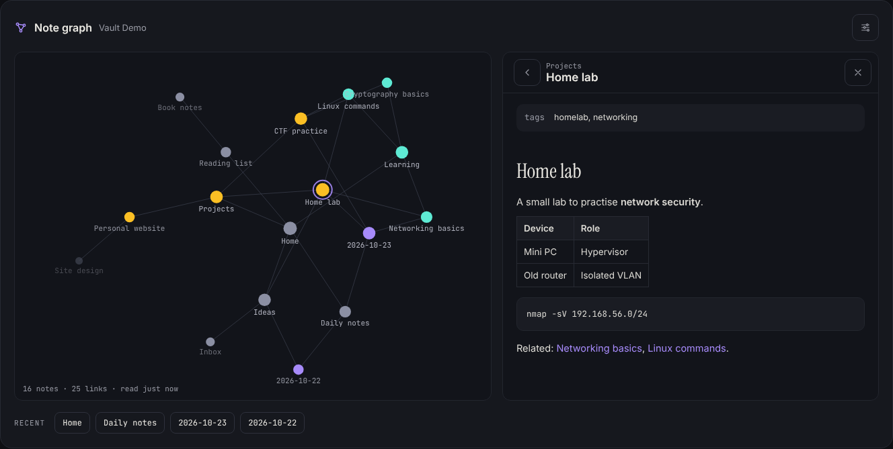

# Obsidian New Tab

A browser extension for **Microsoft Edge** and **Google Chrome** that replaces the new tab page with a personal dashboard: search with prefixes, bookmarks, security news and an interactive graph of your **Obsidian** vault, where you can read your notes without leaving the browser.

It runs entirely on your computer. No server, no account, no analytics, and no access to any website until you allow it.



## Features

- **Clock and greeting**, with your name set from the settings menu (⚙).
- **Search with prefixes**: `gh openssl` searches GitHub, `cve log4j` the NVD, `o meeting` your Obsidian notes. A web address opens directly. <kbd>/</kbd> focuses the search bar.
- **Bookmarks** with site icons from the browser cache. Keys <kbd>1</kbd>–<kbd>9</kbd> open them. Add and remove them from the page.
- **Obsidian graph** drawn with d3-force, following your vault's own graph settings (forces, colour groups, tags, unresolved notes, orphans, arrows). Drag, zoom, hover for a preview, click to read.
- **Note reader**: headings, lists, tasks, tables, code, callouts, highlights, tags, vault images and navigable `[[links]]`. <kbd>Ctrl</kbd>+click opens a note in Obsidian.
- **News** from RSS/Atom feeds in sections you edit from the page (⚙ → *Customize news*): rename, reorder, add any feed by its address, or add a ready-made pack (security, advisories, AI, tech, world, Italian news). CVE identifiers are highlighted, and actively exploited or zero-day vulnerabilities are labelled.



## Security and privacy by design

This project is also an exercise in building a small browser extension with a minimal attack surface. Details are in [SECURITY.md](SECURITY.md).

- **Least privilege.** No host permissions at install time. Each feed site is requested at runtime, one site at a time, and permissions for sites no longer used by any feed are given back automatically.
- **Strict Content Security Policy.** `script-src 'self'`, no inline code, no frames, no objects, fonts bundled locally.
- **Untrusted notes are sanitised.** Markdown goes through marked and DOMPurify, and the result is used as DOM nodes, never reparsed from strings. Dangerous URL schemes are removed.
- **No tracking pixels.** Remote images in notes are blocked by default, and their address is removed before the browser can start the request.
- **Read-only vault access.** The vault is read with the File System Access API in read mode. The cached index keeps only paths, dates, tags and links, never note contents.
- **Verified dependencies.** Third-party libraries are vendored from pinned npm versions with SHA-256 checksums. CI checks they are byte-identical to the published packages.
- **CI on every push.** Unit tests, integrity checks, CodeQL static analysis and gitleaks secret scanning over the full history. Actions are pinned to commit SHAs and kept current by Dependabot.

## Install

1. Download or clone this repository.
2. Open `edge://extensions` (or `chrome://extensions`).
3. Turn on **Developer mode**.
4. Click **Load unpacked** and select the repository folder.
5. Open a new tab. Edge asks whether to keep the change: choose **Keep**.

Each browser profile has its own extensions, so you can install it in one profile only.

### Connect your vault

Click **Connect vault** in the graph panel and select the vault folder (the one that contains `.obsidian`). After a browser restart you may need to confirm access again with the ⟳ button. Until then, the last saved graph is shown.

### Enable news

The first time, the news area asks for permission to read the configured feed sites. Click **Allow access** and confirm in the browser's dialog.

### Try it without a vault

Open `newtab.html?demo=1` from the extension (for example `chrome-extension://<id>/newtab.html?demo=1`). Demo mode uses a fictional vault and sample news, and ignores your personal configuration.

## Configuration

**Name and accent colour**: settings menu (⚙) in the top-right corner. They are saved in the browser.

**News sections and feeds**: ⚙ → *Customize news*. Feeds must use `https://`, and each new feed is downloaded once to check that it really is RSS or Atom. Changes are saved in the browser and take precedence over the configuration file; *Restore defaults* goes back to it.

**Everything else**: create `config.local.json` next to `manifest.json`. It is git-ignored, so your personal setup never ends up in the repository. You only write what you want to change. Objects are merged with the defaults in [`config.js`](config.js), arrays replace them, and `null` removes a default entry.

```json
{
  "label": "Personal",
  "bookmarks": [
    { "name": "YouTube", "description": "Videos", "url": "https://www.youtube.com" }
  ],
  "search": {
    "default": "https://www.google.com/search?q={q}",
    "prefixes": {
      "yt": { "name": "YouTube", "url": "https://www.youtube.com/results?search_query={q}" },
      "mdn": null
    }
  }
}
```

See [`config.local.example.json`](config.local.example.json) and the comments in [`config.js`](config.js) for all options: locale, news sections and feeds, cache times, graph limits and remote images. After editing, reload the extension from the extensions page.

## Permissions

| Permission | Why |
|---|---|
| `storage`, `unlimitedStorage` | Settings, bookmarks, the graph index and the news cache. `unlimitedStorage` lets the index of a large vault fit |
| `favicon` | Site icons for bookmarks, taken from the browser's own cache |
| Optional: feed sites | Requested at runtime, only for the origins of the configured feeds |

## Development

No build step: the extension is plain HTML, CSS and JavaScript (Manifest V3 does not allow remote code, so libraries live in `lib/`). Node.js is only needed for tests and maintenance.

```bash
npm ci            # install the pinned dependencies
npm test          # unit tests (Node's built-in test runner)
npm run check     # vendored files, manifest shape, no personal files tracked
npm run vendor    # refresh lib/ and fonts/ after a dependency update
```

```
manifest.json          extension manifest (MV3) with the CSP
newtab.html            page structure
config.js              default configuration (no personal data)
src/core.js            storage, DOM helpers, config loading, settings
src/header.js          clock, greeting, settings menu, search
src/bookmarks.js       bookmarks and keys 1–9
src/news-config.js     pure functions: section validation, ready-made packs
src/news.js            feeds, runtime permissions, cache
src/news-editor.js     news editor dialog
src/vault-parse.js     pure functions: frontmatter, tags, links, name resolution
src/vault.js           vault access (File System Access API) and index
src/graph.js           graph (d3-force + canvas), filters, hover preview
src/reader.js          note reader (marked + DOMPurify, Obsidian syntax)
src/demo-data.js       fictional vault for ?demo=1
lib/, fonts/           vendored third-party files + CHECKSUMS.sha256
scripts/               vendoring and integrity checks
tests/                 unit tests
```

### Known limitations

- Chromium-based browsers only: reading a local folder relies on the File System Access API.
- Obsidian plugins (Dataview, etc.) are not executed: the reader shows the Markdown as written.

## License

[MIT](LICENSE). Third-party components are listed in [THIRD_PARTY_LICENSES.md](THIRD_PARTY_LICENSES.md).
